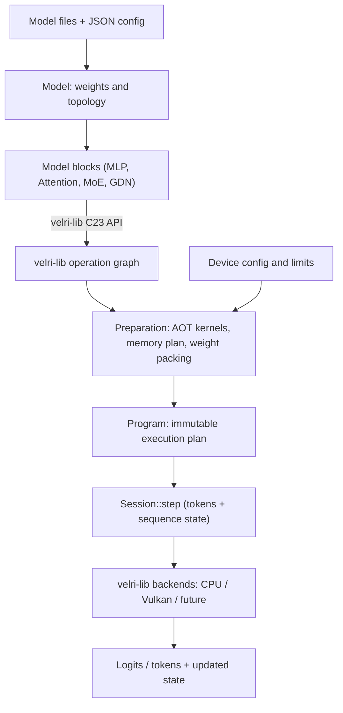

# Velri Engine Architecture and Stack

[Русский](../RU/architecture.md)

**Velri** owns the model and inference layer: loading model files and weights, composing architectures from reusable blocks, resolving placement rules, and managing sessions and generation. All computation, kernel launch graphs, and device backends live inside **`velri-lib/`** ([velri-lib/docs/EN/architecture.md](../../velri-lib/docs/EN/architecture.md)).

**Status:** `VelriLib::velri` (CPU Slang AOT + opt-in Vulkan 1.3 with DAG barrier elision, persistent captured decode graphs, FlashDecoding Split-KV, and shared cross-plan WEIGHT/STATE arenas), streaming C23 JSON + cascading placement (`src/format/json.{h,c}`, `src/config/placement.{h,c}`), engine layer/architecture composition (`src/model/`: GPT-2, Llama/Qwen2), and the public C23 engine runtime (`include/velri/velri.h`, `src/runtime/`) are implemented and tested. `.vtq` weight loading, tokenizers, and CLI/HTTP apps follow in [roadmap.md](roadmap.md).

---

## 1. Request Path from Model to Output



1. **Loading (`Model`):** parse model metadata, validate weight storage, and map tensor names.
2. **Computation description:** a family adapter composes the model from reusable blocks ([blocks-and-config.md](blocks-and-config.md)), emitting operations and explicit state accesses into a `velri-lib` graph.
3. **Preparation (`Program`):** given JSON placement, workload limits (context, batch, memory), and available devices, `velri-lib` validates operation support, selects AOT kernels, packs constant weights, and computes the memory and transfer plan.
4. **Execution (`Session`):** each request owns its token history, mutable state, and execution slots; one `Model` and one `Program` are shared across multiple sessions.

### Responsibility Split and Directory Layout

| Project / Directory | Status | Responsibility |
| :--- | :--- | :--- |
| Velri: `include/velri/` | Implemented | Public C23 engine API (`Context`, `Model`, `Program`, `Session`, `Cancel`) |
| Velri: `src/model/`, `src/config/`, `src/format/` | Active (in progress) | Family adapters (`gpt2`, `llama`), engine layer helpers, cascading JSON placement, streaming JSON scanner, weight format readers |
| Velri: `src/runtime/` | Implemented (core) | Dual-plan zero-duplication runtime, sessions, chunked prefill, zero-alloc deterministic sampling |
| Velri: `apps/` | Planned | Tokenization, chat templates, CLI (`inspect`, `run`, `chat`, `bench`), and optional HTTP/SSE server |
| Velri: `tests/integration/` | Implemented | Public C API consumer check and installed `VelriLib` package test |
| `velri-lib/` | Partially implemented | Tensors, graph, Slang AOT kernels, CPU/Vulkan backends, `velri_pool` ([details](../../velri-lib/docs/EN/architecture.md)) |

Shared blocks never branch on model-family names and contain zero device-specific code (no AVX intrinsics, Vulkan calls, or thread pools). The engine and library never create competing CPU thread pools: one shared pool belongs to the `velri-lib` context.

---

## 2. Building and Integrating `velri-lib`

The engine and `velri-lib/` live in one Git repository and build together without submodules or network downloads. `velri-lib/` also remains a standalone CMake project that builds, tests, and installs independently.

```sh
# Integrated build of Velri + velri-lib and full test suite
cmake -S . -B build -G Ninja -DCMAKE_BUILD_TYPE=Release -DCMAKE_C_COMPILER=clang
cmake --build build
ctest --test-dir build --output-on-failure

# Standalone library build
cmake -S velri-lib -B build-lib -G Ninja -DCMAKE_BUILD_TYPE=Release -DCMAKE_C_COMPILER=clang
cmake --build build-lib
ctest --test-dir build-lib --output-on-failure
```

To verify the consumer boundary against an installed `VelriLib 0.6.0 EXACT` package:

```sh
cmake --install build/velri-lib --prefix /tmp/velri-lib-install
cmake -S . -B build-pkg -G Ninja -DCMAKE_BUILD_TYPE=Release \
  -DVELRI_LIB_SOURCE_DIR= -DCMAKE_PREFIX_PATH=/tmp/velri-lib-install
cmake --build build-pkg && ctest --test-dir build-pkg --output-on-failure
```

---

## 3. Languages, Tooling, and Dependencies

### Languages and standards
- **C23** (`C_STANDARD=23`, `C_STANDARD_REQUIRED=ON`, `C_EXTENSIONS=OFF`) — public headers (`include/velri/`, `include/velri_lib/`), internal backend contract, and core runtime code.
- **C++23** (`CXX_STANDARD=23`, `CXX_STANDARD_REQUIRED=ON`, `CXX_EXTENSIONS=OFF`) — allowed inside implementations (e.g., VMA integration or build tools) behind an `extern "C"` boundary. C++ types and exceptions never cross public headers.
- **Khronos Slang** — unified language for optimized GPU and CPU compute kernels ([velri-lib/docs/EN/kernels.md](../../velri-lib/docs/EN/kernels.md)).
- **Build tools:** CMake 3.21+, Ninja, **Clang 18+** or **GCC 14+**, and **Khronos Slang (`slangc`)** (required at build time). With a compatible Clang, the primary **`slangc -target llvm-ir` → `Clang`** pipeline lowers target-neutral IR without OS/CPU triple hardcoding (covering **Linux** x86-64 / AArch64 / RISC-V 64 / RVV, **Windows** x86-64 / ARM64, **Android** `arm64-v8a` / `x86_64`, and **macOS**); for GCC and older Clang, `AUTO` automatically falls back to `slangc -target host-object-code` (x86-64, AArch64). See [velri-lib/docs/EN/kernels.md](../../velri-lib/docs/EN/kernels.md).

### Build-time tools vs. runtime dependencies

**The shipped engine requires no Slang (`slangc`/`libslang`), LLVM, `shaderc`, Python, PyTorch, or Rust at runtime.** All `.slang` compilation to `.spv` and CPU `.o` runs AOT on the build host.

| Task | Tool / Library | Status | Where Used |
| :--- | :--- | :--- | :--- |
| Kernel compilation (GPU & CPU) | [Khronos Slang](https://github.com/shader-slang/slang) (`slangc`, Apache-2.0 WITH LLVM-exception) | Required (AOT) | **Build time only (AOT):** `.slang` → CPU `.o` (and SPIR-V with `-DVELRI_ENABLE_VULKAN=ON`) |
| SPIR-V validation | [SPIRV-Tools](https://github.com/KhronosGroup/SPIRV-Tools) (`spirv-val`, Apache-2.0) | Active | **Build / CI only:** validate `.spv` against target Vulkan environment |
| Vulkan declarations | [Vulkan-Headers](https://github.com/KhronosGroup/Vulkan-Headers) (Apache-2.0/MIT) | Active | Only when Vulkan backend is enabled in `velri-lib` |
| Vulkan loader | [volk](https://github.com/zeux/volk) (MIT, C) | Planned | Internal Vulkan layer in `velri-lib`; per-device dispatch tables |
| GPU memory allocator | [VMA](https://github.com/GPUOpen-LibrariesAndSDKs/VulkanMemoryAllocator) (MIT, C++/C API) | Planned | Internal to Vulkan backend (`velri-lib` planner owns lifetimes) |
| JSON parsing (config & metadata) | Built-in zero-dependency C23 streaming scanner (`src/format/json.{h,c}`) | Active | Load time only (config & `.vtq` footer); 0 B heap allocs, zero JSON on hot paths |
| C unit tests & fixtures | [Unity](https://github.com/ThrowTheSwitch/Unity) (MIT) + CTest + Python | Planned / CTest active | Automated tests and independent numerical fixture generation |

CPU-only builds never require the Vulkan SDK; disabled backends add zero headers or libraries.

### Optional candidates for later stages
- **Tokenization:** [utf8proc](https://github.com/JuliaStrings/utf8proc) (Unicode normalization/categories) and [PCRE2](https://github.com/PCRE2Project/pcre2) (pre-tokenization regex) are candidates; neither replaces a full tokenizer or Jinja chat-template engine, which will be validated against exact `token IDs` on real models.
- **HTTP/SSE server:** [CivetWeb](https://github.com/civetweb/civetweb) is a candidate for the optional `serve` app (pending streaming, backpressure, and cancellation checks).
- **Reference BLAS for benchmarks:** BLIS / OpenBLAS as external comparison baselines only, never engine dependencies.

### Dependency rules
- Each integration pins an exact release/commit, checksum, and license notices; fetching is an explicit step so subsequent builds work **offline**.
- Third-party types never appear in public `include/velri/` or `include/velri_lib/` headers.
- Before adopting any library, verify whether it spawns internal threads or relies on mutable global state.
