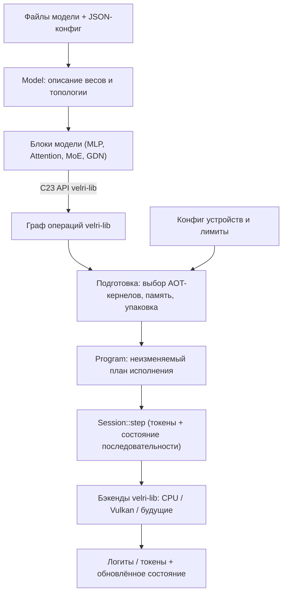

# Архитектура движка Velri и стек

[English](../EN/architecture.md)

**Velri** отвечает за уровень моделей и инференса: загрузку файлов модели и весов, сборку архитектур из переиспользуемых блоков, применение правил размещения, управление сеансами и генерацией. Все вычисления, граф запуска кернелов и бэкенды устройств инкапсулированы в библиотеке **`velri-lib/`** ([velri-lib/docs/RU/architecture.md](../../velri-lib/docs/RU/architecture.md)).

**Статус:** сейчас реализованы CPU-операции `VelriLib::cpu` и интеграционный тест подключения из Velri. Остальные модули движка (`src/model/`, `src/format/`, `src/runtime/`, приложения) запланированы в [roadmap.md](roadmap.md).

---

## 1. Путь запроса от модели до результата



1. **Загрузка (`Model`):** читаем конфигурацию модели, проверяем контейнер весов и сопоставляем имена тензоров.
2. **Описание вычислений:** адаптер семейства собирает модель из переиспользуемых блоков ([blocks-and-config.md](blocks-and-config.md)), добавляя операции и явные обращения к состоянию в граф `velri-lib`.
3. **Подготовка (`Program`):** с учётом JSON-размещения, лимитов (контекст, батч, память) и доступных устройств `velri-lib` проверяет поддержку операций, выбирает AOT-кернелы, упаковывает постоянные веса и строит план памяти и передач.
4. **Исполнение (`Session`):** каждый запрос держит собственную историю токенов, изменяемое состояние и рабочие слоты; одна `Model` и один `Program` разделяются между несколькими сеансами.

### Граница ответственности и каталог исходников

| Проект / каталог | Статус | Ответственность |
| :--- | :--- | :--- |
| Velri: `include/velri/` | План | Публичный C23 API движка (`Context`, `Model`, `Program`, `Session`) |
| Velri: `src/model/`, `src/format/` | План | Адаптеры семейств, переиспользуемые блоки, JSON-конфиг, чтение форматов весов |
| Velri: `src/runtime/`, `apps/` | План | Сеансы, батчинг, семплирование, токенизация, CLI и HTTP/SSE-сервер |
| Velri: `tests/integration/` | Есть | Проверка подключения публичного C API и CMake-пакета `VelriLib` |
| `velri-lib/` | Частично есть | Тензоры, граф, Slang AOT-кернелы, бэкенды CPU/Vulkan, `velri_pool` ([подробнее](../../velri-lib/docs/RU/architecture.md)) |

Общие блоки не ветвятся по имени семейства модели и не содержат кода конкретных устройств (AVX-инструкций, вызовов Vulkan или пула потоков). Движок и библиотека не заводят конкурирующих пулов CPU: единый пул принадлежит контексту `velri-lib`.

---

## 2. Сборка и подключение `velri-lib`

Движок и `velri-lib/` живут в одном репозитории с общей историей Git и собираются вместе без подмодулей и без скачивания из сети. При этом `velri-lib/` сохраняет собственную точку входа CMake и может собираться и устанавливаться отдельно.

```sh
# Совместная сборка Velri + velri-lib и прогон всех тестов
cmake -S . -B build -G Ninja -DCMAKE_BUILD_TYPE=Release -DCMAKE_C_COMPILER=clang
cmake --build build
ctest --test-dir build --output-on-failure

# Автономная сборка только библиотеки
cmake -S velri-lib -B build-lib -G Ninja -DCMAKE_BUILD_TYPE=Release -DCMAKE_C_COMPILER=clang
cmake --build build-lib
ctest --test-dir build-lib --output-on-failure
```

Для проверки чистоты границы потребителя движок также можно собрать против установленного пакета `VelriLib 0.1.0 EXACT`:

```sh
cmake --install build/velri-lib --prefix /tmp/velri-lib-install
cmake -S . -B build-pkg -G Ninja -DCMAKE_BUILD_TYPE=Release \
  -DVELRI_LIB_SOURCE_DIR= -DCMAKE_PREFIX_PATH=/tmp/velri-lib-install
cmake --build build-pkg && ctest --test-dir build-pkg --output-on-failure
```

---

## 3. Языки, инструменты и зависимости

### Языки и стандарты
- **C23** (`C_STANDARD=23`, `C_STANDARD_REQUIRED=ON`, `C_EXTENSIONS=OFF`) — публичные заголовки (`include/velri/`, `include/velri_lib/`), внутренний контракт бэкендов и базовый код рантайма.
- **C++23** (`CXX_STANDARD=23`, `CXX_STANDARD_REQUIRED=ON`, `CXX_EXTENSIONS=OFF`) — допустим внутри реализаций (например, для обвязки VMA или инструментов сборки) за `extern "C"` границей. Типы и исключения C++ наружу не выходят.
- **Khronos Slang** — единый язык оптимизированных вычислительных кернелов для GPU и CPU ([velri-lib/docs/RU/kernels.md](../../velri-lib/docs/RU/kernels.md)).
- **Сборка:** CMake 3.21+, Ninja, **Clang 18+** или **GCC 14+**. Целевые ОС — Linux, Windows и Android ARM64 (на сегодня в CI проверен Linux x86-64, AArch64 и RISC-V 64; сборки Windows и Android NDK Clang проверяются отдельно на следующих этапах).

### Инструменты сборки vs зависимости рантайма

**Готовому движку при запуске не нужны Slang (`slangc`/`libslang`), LLVM, `shaderc`, Python, PyTorch и Rust.** Вся компиляция `.slang` в `.spv` и CPU `.o` выполняется на машине сборки (AOT).

| Задача | Инструмент / библиотека | Статус | Где используется |
| :--- | :--- | :--- | :--- |
| Компиляция кернелов (GPU и CPU) | [Khronos Slang](https://github.com/shader-slang/slang) (`slangc`, Apache-2.0 WITH LLVM-exception) | Активно (Этап 2) | **Только сборка (AOT):** `.slang` → SPIR-V и CPU `.o` + reflection |
| Валидация SPIR-V | [SPIRV-Tools](https://github.com/KhronosGroup/SPIRV-Tools) (`spirv-val`, Apache-2.0) | Активно | **Только сборка / CI:** проверка `.spv` под целевой профиль Vulkan |
| Объявления Vulkan | [Vulkan-Headers](https://github.com/KhronosGroup/Vulkan-Headers) (Apache-2.0/MIT) | Активно | Только при включённом Vulkan-бэкенде внутри `velri-lib` |
| Загрузка функций Vulkan | [volk](https://github.com/zeux/volk) (MIT, C) | План | Внутренний слой Vulkan в `velri-lib`; отдельные таблицы на устройство |
| Аллокатор памяти GPU | [VMA](https://github.com/GPUOpen-LibrariesAndSDKs/VulkanMemoryAllocator) (MIT, C++/C API) | План | Внутри Vulkan-бэкенда (время жизни ресурсов задаёт планировщик `velri-lib`) |
| Разбор JSON (конфиг и метаданные) | [yyjson](https://github.com/ibireme/yyjson) (MIT, C) | План | Только при загрузке модели/конфига; на горячем пути JSON нет |
| C-тесты и фикстуры | [Unity](https://github.com/ThrowTheSwitch/Unity) (MIT) + CTest + Python | План / CTest есть | Автотесты и генерация независимых численных фикстур |

CPU-сборка не требует Vulkan SDK; выключенные бэкенды не добавляют своих заголовков и библиотек в сборку.

### Необязательные кандидаты на более поздние этапы
- **Токенизация:** [utf8proc](https://github.com/JuliaStrings/utf8proc) (нормализация/категории Unicode) и [PCRE2](https://github.com/PCRE2Project/pcre2) (pre-tokenization regex) — кандидаты; готового токенизатора и Jinja-движка чат-шаблонов они не заменяют, окончательный выбор делается на реальных моделях с проверкой точных `token IDs`.
- **HTTP/SSE-сервер:** [CivetWeb](https://github.com/civetweb/civetweb) — кандидат для отдельного приложения `serve` (нужна проверка потоковой выдачи, backpressure и отмены).
- **Контрольные BLAS-реализации для бенчмарков:** BLIS / OpenBLAS — только как внешний ориентир в тестах/замерах, не зависимость движка.

### Правила подключения зависимостей
- При интеграции фиксируется конкретный release/commit, контрольная сумма и лицензионные уведомления; получение зависимостей — отдельный явный шаг, после которого сборка работает **офлайн**.
- Типы сторонних библиотек не проникают в публичные заголовки `include/velri/` и `include/velri_lib/`.
- Перед интеграцией проверяется, создаёт ли библиотека собственные потоки и хранит ли глобальное состояние.
