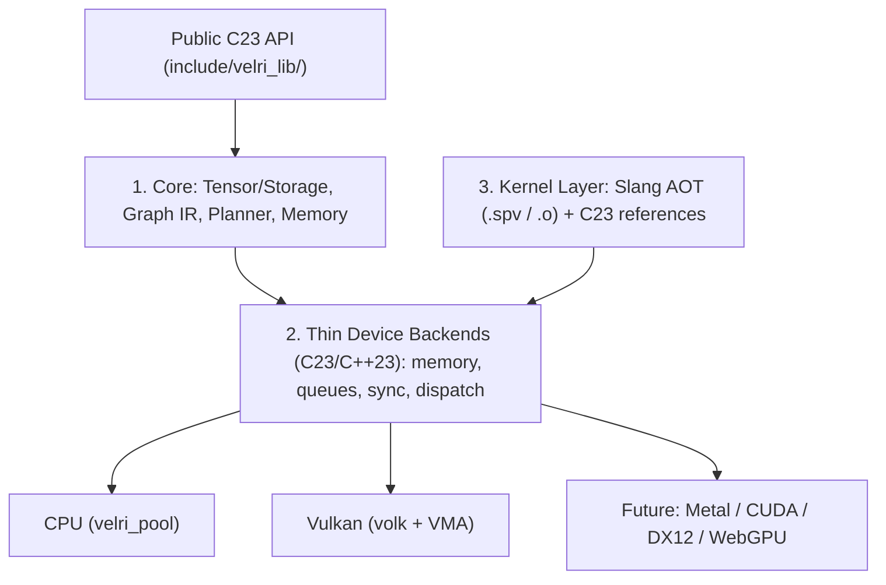

# Velri-lib Architecture

[Русский](../RU/architecture.md)

**Velri-lib** is the computation library living in the `velri-lib/` directory of the Velri repository. It provides mathematical operations, a unified kernel system, compute graphs, and device backends behind a common **C23 API** (`include/velri_lib/`). Implementation internals may use **C23 and C++23**; the library builds and runs tests standalone through CMake with no Python or PyTorch dependency.

**Status:** the C23 CPU operations in `VelriLib::cpu` ([cpu-kernels.md](cpu-kernels.md)) and the deprecated `VelriLib::cpu_linear` target are implemented and tested today. The compute graph, backend registry, Slang pipeline, and Vulkan backend below describe the target architecture.

---

## 1. Boundary Between Velri-lib and Velri

Adding a new model block built from supported operations requires no changes to `Velri-lib`. Adding a new backend for supported operations requires no changes to `Velri`.

| Velri-lib | Velri (Engine) |
| :--- | :--- |
| Tensor views, storage descriptors, layouts, and numeric formats | Model configuration, weight-name mapping, and family adapters |
| Unified kernel suite (**Slang AOT**) and independent C23 references | Reusable blocks (`MLP`, `Attention`, `MoE`, `GDN`), layers, and architectures |
| Graph builder, validation, kernel selection, and launch plans | Model graph assembly via the library's C API |
| Memory planning, weight packing, RAM transfers, and dependencies | Placement policies, resource budgets, and workload limits |
| Backend registry, devices, `velri_pool`, GPU queues, and completion | `Model`, `Program`, `Session`, request batching, generation, and sampling |
| Mathematical decoding of quantized weight formats | Model file/container I/O, metadata, tokenization, and CLI/HTTP |
| Operation references, contract tests, and kernel benchmarks | Full-model fixtures, logit verification, and end-to-end benchmarks |

The engine consumes the library strictly through public headers in `include/velri_lib/` and exported CMake targets (`VelriLib::cpu` and future targets). Private headers under `velri-lib/src/` are never exposed.

---

## 2. Three-Layer Library Design

To ensure adding a GPU API does not require rewriting math and adding an operation does not bloat backend vtables, the library is split into three layers:

1. **Core (`core`, `ops`, `graph`, `plan`, `runtime`):** validates shapes, dtypes, strides, and state accesses; builds memory plans; places operations across allowed devices; inserts explicit transfers and layout conversions.
2. **Kernel layer ([kernels.md](kernels.md)):** unified **Khronos Slang** modules compiled AOT at build time into SPIR-V (Vulkan), native object code (CPU), and prospectively MSL/CUDA/DXIL/WGSL. Simple portable C23 reference implementations live alongside for correctness checks.
3. **Thin device backends (`src/backend/`):** handle device discovery, physical memory, queues/threads, synchronization, and launching precompiled artifacts. The first two backends are **CPU** and **Vulkan**.

---

## 3. Memory, Views, and K/V Roles

Tensor descriptions are separated from memory ownership:
- **`Storage`** has an owner, device, actual physical allocation size (including alignment and allocator overhead), and lifetime.
- **`TensorView`** references a `Storage` with shape, `dtype`, offset, and strides. Creating a view copies no data.

A core invariant for model state: **K and V are input roles to attention, not a mandate to allocate two buffers.** An architecture may:
- store K and V separately;
- bind both roles to one shared storage;
- store only V and reconstruct K via an explicit transform (`K = RoPE(V * w_k)` in Gemma 4);
- derive K and V from a shared compressed/latent state;
- maintain recurrent state (`GatedDeltaNet`), convolution history, or multi-stream residuals (`Hyper-Connections`).

The allocator allocates only explicitly declared storages and never branches on model-family names.

| Object | Owner and Lifetime |
| :--- | :--- |
| Raw and prepared weights | Client / `Model`; immutable after preparation, shared across sessions. Packing identity = owner + weight version + device + implementation + packing format |
| Graph plan and selected kernels | Immutable prepared plan; shared across concurrent execution slots |
| Sequence state (KV, GDN, conv) | Specific session; persists across steps |
| Working memory (`scratch`), dynamic args, staging | Individual execution slot; reused by lifetime analysis after its last consumer |

---

## 4. Operation Graph and Launch Graph

- **Operation graph** describes the math: coarse-grained operation nodes (`Linear`, `RMSNorm`, `RoPE`, `Attention`, `GDN`, `FWHT`, etc.), value edges, and explicit state reads/writes. Building the graph runs no compute and is device-agnostic.
- **Preparation (`prepare`)** lowers the operation graph into a **launch graph**: queries allowed devices, selects AOT kernels (including AOT-fused variants), computes memory budgets, packs constant weights, and inserts explicit transfers and layout conversions.
- **Repeated execution** reuses the prepared plan with bounded dynamic parameters (token count, positions, history length, MoE routes) without rebuilding the graph or allocating heap memory (`0 B`).

---

## 5. Backend Registry and Shared Contract

Backends are registered **statically at build time** through an explicit CMake registration list (disabled backends pull in no headers, SDKs, or build dependencies; CPU builds never require the Vulkan SDK). Dynamic `.so`/`.dll` plugin loading and a stable binary ABI are out of scope for the initial version.

Each backend implements six function groups in a plain C struct — without adding a separate function pointer per operation (`gemm`, `rope`, `qsa`, etc.):

| Group | Responsibility |
| :--- | :--- |
| Registration | Name (`cpu`, `vulkan`, ...), internal contract version, `backends.<name>` option validation, device enumeration |
| Device | Open, capability/limit queries, close after dependent resources are released |
| Memory | Size/alignment checks, allocate/free, transfer to and from a host RAM buffer |
| Preparation | `query_operation` (full shape, dtype, stride, aliasing, state, and accuracy check), prepare implementations |
| Execution | `submit` prepared work with slot, buffers, and bounded dynamic arguments |
| Completion | `poll` / `wait`, final status, release completion record |

**Shared contract rules:**
- **No backend-name branches** in models or the common planner; new operations are added to the operation registry (with validator and reference), and each backend either supports them or explicitly returns `VELRI_ERR_UNSUPPORTED`.
- **No silent CPU fallback mid-step:** selecting another allowed device or an equivalent operation decomposition happens only during `prepare` when policy permits, and appears in the plan report.
- **RAM transfer bus between any two backends:** the baseline path `Device A → agreed RAM buffer → Device B` avoids quadratic pairwise adapters. Direct device-to-device copies can be added later as optional accelerators.
- **Acceptance ≠ completion:** if an error occurs after partial submission, the backend must still return a completion object covering all accepted work so the runtime waits before releasing memory. See [execution.md](execution.md).

---

## 6. Data Types

Target compute and storage formats are **`F64`, `FP32`, `FP16`, `BF16`, `INT8`**, plus low-bit quantized weights with explicit mathematical decoding.

Input storage, weight storage, accumulator, and output dtypes are specified independently. Devices validate support for the full combination. Numerical accuracy contracts and verification rules are defined in [kernels.md](kernels.md#5-numerical-contracts-and-verification).

---

## 7. `velri-lib/` Directory Layout

| Directory | Status | Purpose |
| :--- | :--- | :--- |
| `include/velri_lib/` | Implemented (`kernels.h`, `types.h`, `pool.h`, `linear_typed.h`, `ops.h`, legacy `linear.h`) | Public C23 library API |
| `src/backend/cpu/` | Implemented (C23 + AVX2 + AVX-512) | Current `VelriLib::cpu` and legacy `cpu_linear` |
| `src/platform/` | Implemented (`cpu_caps.c`, `pool.c`) | ISA/cache detection, persistent `velri_pool`, future OS services |
| `src/kernels/slang/` | Planned | Unified Slang kernel modules (AOT → SPIR-V and CPU `.o`) |
| `src/core/`, `src/ops/`, `src/graph/` | Planned | Tensors, storage, operation registry, and graph builder |
| `src/plan/`, `src/runtime/` | Planned | Memory/placement planner, execution slots, dependencies, completion |
| `src/backend/vulkan/` | Planned | Vulkan 1.1+ backend (`volk`, VMA, SPIR-V execution) |
| `tests/`, `tools/`, `cmake/` | Implemented | References, fixtures, contract tests, benchmarks, AArch64/RISC-V toolchains |

Planned directories are not populated with stub APIs ahead of working code. Standalone and integrated build instructions live in [velri-lib/README.md](../../README.md) and [Velri Architecture](../../../docs/EN/architecture.md).
