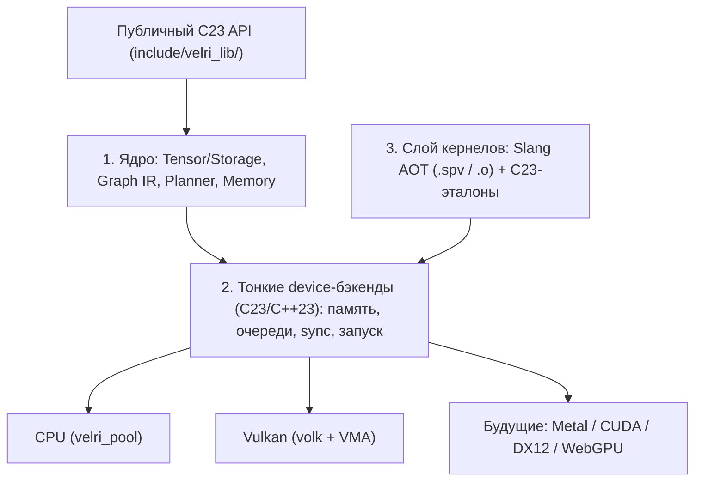

# Архитектура Velri-lib

[English](../EN/architecture.md)

**Velri-lib** — вычислительная библиотека в каталоге `velri-lib/` репозитория Velri. Она предоставляет математические операции, единую систему кернелов, граф вычислений и бэкенды устройств за общим **C23 API** (`include/velri_lib/`). Внутри реализации допускается **C23 и C++23**; библиотека собирается и тестируется автономно через CMake без Python и PyTorch.

**Статус:** сейчас реализованы и протестированы CPU-операции `VelriLib::cpu` ([cpu-kernels.md](cpu-kernels.md)) и устаревший таргет `VelriLib::cpu_linear`. Вычислительный граф, реестр бэкендов, Slang-конвейер и Vulkan-бэкенд описаны ниже как целевая архитектура.

---

## 1. Граница между Velri-lib и Velri

Новый блок модели из поддерживаемых операций не требует изменений в `Velri-lib`. Новый бэкенд для поддерживаемых операций не требует изменений в `Velri`.

| Velri-lib | Velri (движок) |
| :--- | :--- |
| Описания тензоров, хранилищ, раскладок и числовых форматов | Конфигурация модели, сопоставление имён весов и адаптеры семейств |
| Единая база кернелов (**Slang AOT**) и независимые C23-эталоны | Переиспользуемые блоки (`MLP`, `Attention`, `MoE`, `GDN`), слои и архитектуры |
| Конструктор графа, валидация, выбор реализаций и план запусков | Сборка вычислений модели через C API библиотеки |
| План памяти, упаковка весов, передачи через RAM и зависимости | Политики размещения, бюджеты ресурсов и пределы нагрузки |
| Реестр бэкендов, устройства, `velri_pool`, очереди GPU и завершение | `Model`, `Program`, `Session`, батчинг запросов, генерация и семплирование |
| Математическое декодирование квантованных форматов весов | Чтение файлов модели, контейнеров, метаданных, токенизация и CLI/HTTP |
| Эталоны операций, контрактные тесты и бенчмарки кернелов | Фикстуры целых моделей, сверка логитов и end-to-end замеры |

Движок подключает библиотеку только через публичные заголовки `include/velri_lib/` и экспортированные цели CMake (`VelriLib::cpu` и будущие цели). Внутренние заголовки из `velri-lib/src/` наружу не экспортируются.

---

## 2. Трёхслойное устройство библиотеки

Чтобы добавление нового GPU API не требовало переписывать математику, а добавление новой операции не раздувало таблицу функций бэкендов, библиотека разделена на три слоя:

1. **Ядро (`core`, `ops`, `graph`, `plan`, `runtime`):** проверяет формы, типы, шаги и доступы к состоянию, строит план памяти, размещает операции по разрешённым устройствам, вставляет явные передачи и преобразования раскладок.
2. **Слой кернелов ([kernels.md](kernels.md)):** единые модули на **Khronos Slang**, AOT-компилируемые на этапе сборки в SPIR-V (Vulkan), машинный объектный код (CPU), а в перспективе — в MSL/CUDA/DXIL/WGSL. Рядом живут простые переносимые C23-эталоны для проверки корректности.
3. **Тонкие device-бэкенды (`src/backend/`):** отвечают только за открытие устройств, физическую память, очереди/потоки, синхронизацию и запуск уже скомпилированных артефактов. Первые два бэкенда — **CPU** и **Vulkan**.

---

## 3. Память, представления и роли K/V

Описание тензора и владение памятью разделены:
- **Хранилище (`Storage`)** имеет владельца, устройство, фактический физический размер (с выравниванием и накладными расходами аллокатора) и время жизни.
- **Представление (`TensorView`)** ссылается на хранилище и задаёт форму, `dtype`, смещение и шаги. Создание представления не копирует данные.

Ключевой инвариант для состояния моделей: **K и V — это входные роли операции attention, а не обязательство выделять два буфера.** Архитектура может:
- хранить K и V раздельно;
- ссылаться обеими ролями на одно хранилище;
- хранить только V и восстанавливать K через явное преобразование (`K = RoPE(V * w_k)` в Gemma 4);
- получать K и V из общего сжатого/латентного состояния;
- хранить рекуррентное состояние (`GatedDeltaNet`), буфер свёртки или многопоточный residual (`Hyper-Connections`).

Аллокатор выделяет только явно объявленные хранилища и не содержит ветвлений по именам семейств моделей.

| Объект | Владелец и время жизни |
| :--- | :--- |
| Исходные и упакованные веса | Клиент / `Model`; неизменяемы после подготовки, разделяются между сеансами. Идентичность упаковки = владелец + версия весов + устройство + реализация + формат упаковки |
| План графа и выбранные кернелы | Неизменяемый подготовленный план; разделяется между параллельными слотами |
| Состояние последовательности (KV, GDN, conv) | Конкретный сеанс; сохраняется между шагами |
| Рабочая память (`scratch`), динамические параметры, staging | Отдельный слот исполнения; переиспользуется по графу времени жизни после последнего потребителя |

---

## 4. Граф операций и граф запусков

- **Граф операций** описывает математику: узлы операций (достаточно крупные для эффективных кернелов: `Linear`, `RMSNorm`, `RoPE`, `Attention`, `GDN`, `FWHT` и т.п.), связи значений и явные чтения/записи состояния. Построение графа не запускает вычисления и не привязано к конкретному устройству.
- **Подготовка (`prepare`)** преобразует граф операций в **граф запусков**: проверяет поддержку на разрешённых устройствах, выбирает AOT-кернелы (включая AOT-слитые варианты), считает бюджет памяти, упаковывает постоянные веса и вставляет явные передачи и преобразования раскладок.
- **Повторный запуск** использует подготовленный план с изменяемыми в заданных пределах параметрами (число токенов, позиции, длина истории, маршруты MoE) без пересборки графа и без аллокаций в куче (`0 B`).

---

## 5. Реестр бэкендов и общий контракт

Бэкенды подключаются **статически при сборке** через явный список регистраций в CMake (выключенный бэкенд не тянет свои заголовки, SDK и зависимости; CPU-сборка не требует Vulkan SDK). Динамическая загрузка `.so`/`.dll` и стабильный бинарный ABI не входят в первую версию.

Каждый бэкенд реализует 6 групп функций в простой C-структуре без отдельных полей под каждую операцию (`gemm`, `rope`, `qsa` и т.д.):

| Группа | Обязанность |
| :--- | :--- |
| Регистрация | Имя (`cpu`, `vulkan`, ...), версия внутреннего контракта, валидация настроек `backends.<имя>`, перечисление устройств |
| Устройство | Открытие, запрос возможностей и ограничений, закрытие после освобождения зависимых ресурсов |
| Память | Проверка размеров/выравнивания, выделение/освобождение, передача в буфер RAM и обратно |
| Подготовка | `query_operation` (по полному описанию формы, типов, шагов, алиасинга, состояния и точности), подготовка реализаций |
| Исполнение | `submit` подготовленной работы со слотом, буферами и динамическими параметрами |
| Завершение | `poll` / `wait`, статус выполнения, освобождение объекта завершения |

**Общие правила контракта:**
- **Никаких веток по имени бэкенда** в моделях и общем планировщике; новые операции добавляются в общий реестр операций (с валидатором и эталоном), а бэкенд либо поддерживает их, либо возвращает явный отказ `VELRI_ERR_UNSUPPORTED`.
- **Никакого скрытого fallback на CPU во время шага:** выбор другого устройства или эквивалентного разложения операции возможен только на этапе `prepare`, если это разрешено политикой размещения, и отражается в отчёте плана.
- **Обмен между любыми двумя бэкендами через RAM:** базовый маршрут `Устройство A → согласованный буфер RAM → Устройство B` избавляет от квадратичного числа попарных адаптеров. Прямые межустройственные копии добавляются позже как необязательное ускорение.
- **Принятие ≠ завершение:** если ошибка возникла после частичного запуска, бэкенд обязан вернуть объект завершения для всех уже принятых работ, чтобы рантайм дождался их окончания до освобождения памяти. Подробнее — в [execution.md](execution.md).

---

## 6. Типы данных

Целевые вычислительные и хранимые форматы: **`F64`, `FP32`, `FP16`, `BF16`, `INT8`**, а также низкобитные квантованные веса с явным математическим декодированием.

Хранение входов, хранение весов, накопитель и выход описываются раздельно. Устройство подтверждает поддержку полной комбинации. Общие правила численных допусков и проверки точности описаны в [kernels.md](kernels.md#5-численные-контракты-и-верификация).

---

## 7. Структура каталогов `velri-lib/`

| Каталог | Статус | Назначение |
| :--- | :--- | :--- |
| `include/velri_lib/` | Есть (`kernels.h`, `types.h`, `pool.h`, `linear_typed.h`, `ops.h`, legacy `linear.h`) | Публичный C23 API библиотеки |
| `src/backend/cpu/` | Есть (C23 + AVX2 + AVX-512) | Текущая реализация `VelriLib::cpu` и legacy `cpu_linear` |
| `src/platform/` | Есть (`cpu_caps.c`, `pool.c`) | Определение ISA/кэшей, постоянный пул потоков `velri_pool`, далее сервисы ОС |
| `src/kernels/slang/` | План | Единые модули кернелов на Slang (AOT → SPIR-V и CPU `.o`) |
| `src/core/`, `src/ops/`, `src/graph/` | План | Тензоры, хранилища, реестр операций и конструктор графа |
| `src/plan/`, `src/runtime/` | План | Планировщик памяти/размещения, слоты исполнения, зависимости и завершение |
| `src/backend/vulkan/` | План | Vulkan 1.1+ бэкенд (`volk`, VMA, исполнение SPIR-V) |
| `tests/`, `tools/`, `cmake/` | Есть | Эталоны, фикстуры, контрактные тесты, бенчмарки, тулчейны AArch64/RISC-V |

Пустые каталоги заранее не заводятся; модули появляются вместе с проверяемой реализацией. Инструкции сборки библиотеки и её интеграции в Velri — в [velri-lib/README.md](../../README.md) и [архитектуре Velri](../../../docs/RU/architecture.md).
